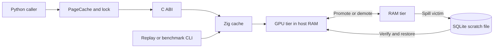

# Tiered KV cache

[](https://github.com/asigdel29/tiered-kv-cache/actions/workflows/ci.yml)
[](LICENSE)

Store immutable key/value cache pages under a fixed slot budget. Use the Zig executable to replay a trace or the Python API to manage pages by handle.

## Contents

- [Overview](#overview)
- [Architecture](#architecture)
- [Requirements and quick start](#requirements-and-quick-start)
- [Usage](#usage)
- [Configuration](#configuration)
- [Tests and benchmarks](#tests-and-benchmarks)
- [Project structure](#project-structure)
- [Documentation](#documentation)
- [Contributing](#contributing)
- [License](#license)

## Overview

Use this cache to study page placement, pinning, and spill costs. The GPU and RAM tiers both use Zig buffers in host memory. SQLite stores the disk tier on the selected filesystem. The OS can cache disk reads. Physical GPU transfers and pinned host allocations remain future work.

A page keeps the same handle when it moves between tiers. The cache checks the SHA-256 digest when it restores a disk page. Release the handle after its last consumer finishes.

## Architecture



| Component | Responsibility |
| --- | --- |
| Python binding | Validate handle ownership, serialize calls, and return independent byte strings. |
| Native cache | Track allocations, pin counts, occupancy, access order, and page digests. |
| SQLite store | Read and write page rows. Commit disk changes before resident placement changes. |
| Native CLI | Replay seeded workloads, verify restored bytes, and report timings. |

## Requirements and quick start

Use Linux or macOS with Zig 0.16.0 and the SQLite development library. Run these commands from a checkout.

```sh
make build
zig-out/bin/kv-cache replay --rounds 1
```

Expect six verified reads, with one GPU hit, one RAM hit, and four disk hits. Install the wheel for Python access using the [runbook](docs/runbook.md).

## Usage

```python
from tiered_kv_cache import PageCache

with PageCache(None, page_bytes=4, gpu_pages=1, ram_pages=1, disk_pages=1) as cache:
    handle = cache.put(b"keys")
    cache.prefetch(handle)
    with cache.pin(handle) as payload:
        assert payload == b"keys"
    cache.release(handle)
```

A pin keeps the page in the GPU tier until the context exits. A synchronous prefetch also promotes a page. Both operations count a source hit.

## Configuration

| Setting | Meaning |
| --- | --- |
| `page_bytes` | Exact byte count of each immutable payload. |
| `gpu_pages`, `ram_pages`, `disk_pages` | Positive slot limits for the three tiers. |
| Python `directory` | Existing scratch directory. Use `None` to select the system temporary directory. |
| CLI `--directory` | Existing scratch directory for SQLite. The native default is `/tmp`. |
| CLI `--output` | Benchmark JSON path. The default is `bench-results/cache.json`. |

The budget bounds the number of pages. Index entries, caller copies, and SQLite journals consume additional space.

## Tests and benchmarks

| Command | Result |
| --- | --- |
| `make check` | Checks Zig format, runs native tests, and exercises the Python API. |
| `make demo ARGS="--rounds 100"` | Runs the placement trace and verifies 600 reads. |
| `make bench` | Writes raw samples, traces, source hits, and paired latency intervals for three workloads. |

CI tests installed wheels on Python 3.10, 3.12, and 3.14. The benchmark job retains its JSON artifact for 30 days. See the [measured test results](docs/test-log.md).

## Project structure

| Path | Contents |
| --- | --- |
| [src](src) | Zig cache core, SQLite interface, C ABI, and CLI. |
| [tiered_kv_cache](tiered_kv_cache) | Python handles, binding, and command entry points. |
| [tests](tests) | API, recovery, capacity, and workload checks. |
| [docs](docs) | System design, runbook, and test log. |

## Documentation

| Guide | Use it to |
| --- | --- |
| [System design](docs/system-design.md) | Locate each component and its owner. |
| [Page placement](docs/design/placement.md) | Trace promotion, eviction, commit, and rollback. |
| [Handle ownership](docs/design/handles.md) | Check lifetimes, pin counts, and thread ownership. |
| [Measurement design](docs/design/measurement.md) | Read the report fields and the 95% interval. |
| [Runbook](docs/runbook.md) | Build, install, measure, and troubleshoot. |
| [Test log](docs/test-log.md) | Inspect the tested revision, environment, and results. |
| [Graphify report](graphify-out/GRAPH_REPORT.md) | Locate source relationships in the [JSON graph](graphify-out/graph.json) or [interactive map](graphify-out/graph.html). |

## Contributing

Read the [repository instructions](AGENTS.md) before changing the page API. Run `make check` and include the affected replay or benchmark in the pull request.

To refresh the source map, install Graphify with `uv tool install graphifyy==0.9.76`. Stage new Zig and Python files, run `make graph`, then run `graphify query "PageCache"`.

## License

The source and tests use the [Apache License 2.0](LICENSE).
