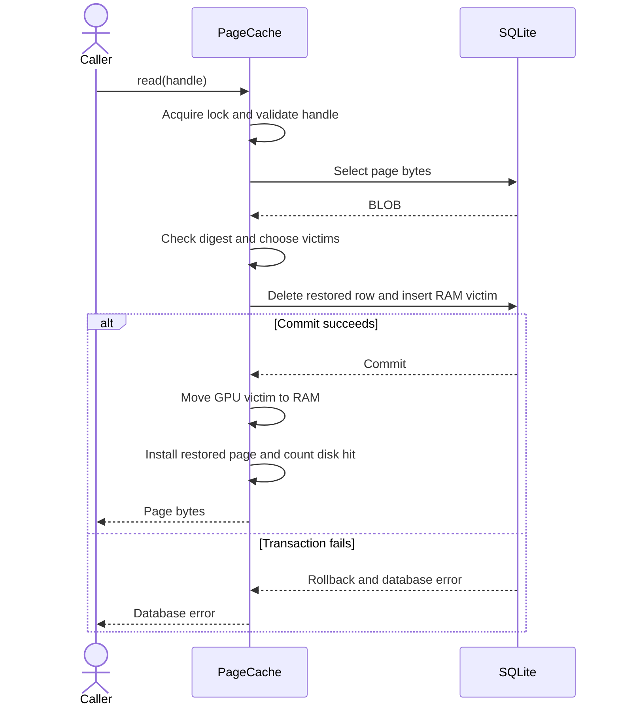

# Page placement and the disk transaction

## Admission and promotion

A new page enters the GPU tier. A GPU hit moves the page to the newest position. A RAM or disk hit promotes the requested page. Admission chooses the oldest unpinned GPU victim. Its demotion can send the oldest RAM page to disk. A RAM hit frees its own slot for the GPU victim.

The diagram shows a disk read with both resident tiers full and an available GPU victim.

SQLite commits before the cache changes resident metadata. A missing row or a checksum failure raises `CorruptPage` before admission. Failed reads leave the hit counts unchanged.

## Worked trace

Use a one-slot limit for each tier. Insert A, B, and C in that order. Each read returns the original bytes.

| Operation | GPU | RAM | Disk | Source hit |
| --- | --- | --- | --- | --- |
| Insert A | A | — | — | — |
| Insert B | B | A | — | — |
| Insert C | C | B | A | — |
| Read C | C | B | A | GPU |
| Read B | B | C | A | RAM |
| Read A | A | B | C | Disk |

A disk restore can succeed with every slot full. The transaction removes the restored row and inserts the displaced RAM page before commit.
The source tier determines the hit counter. The destination tier determines the new slot count.

See the [native cache](../../src/cache.zig) and the [SQLite store](../../src/storage.zig).
