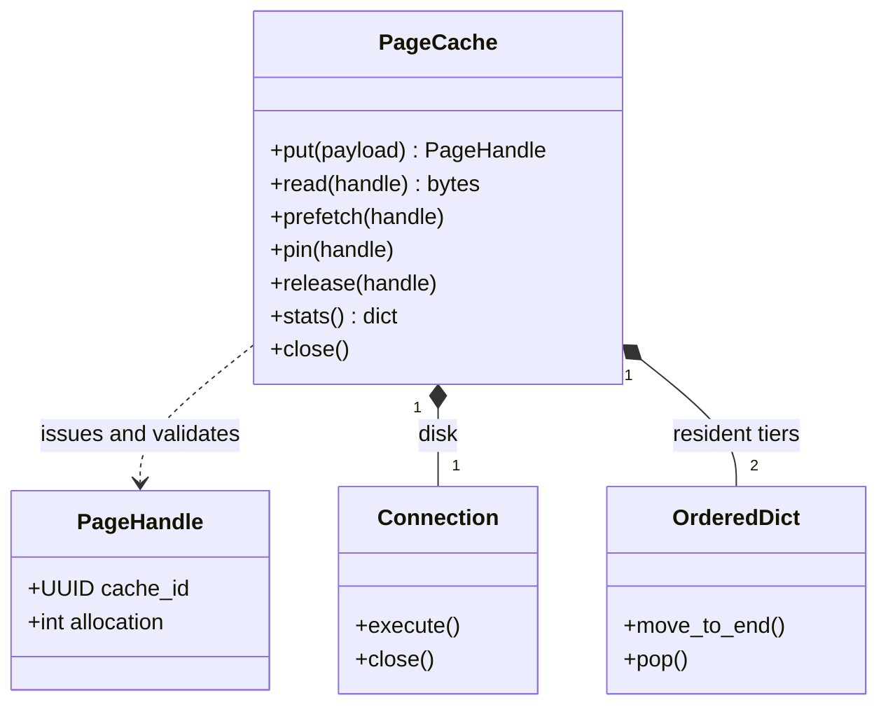
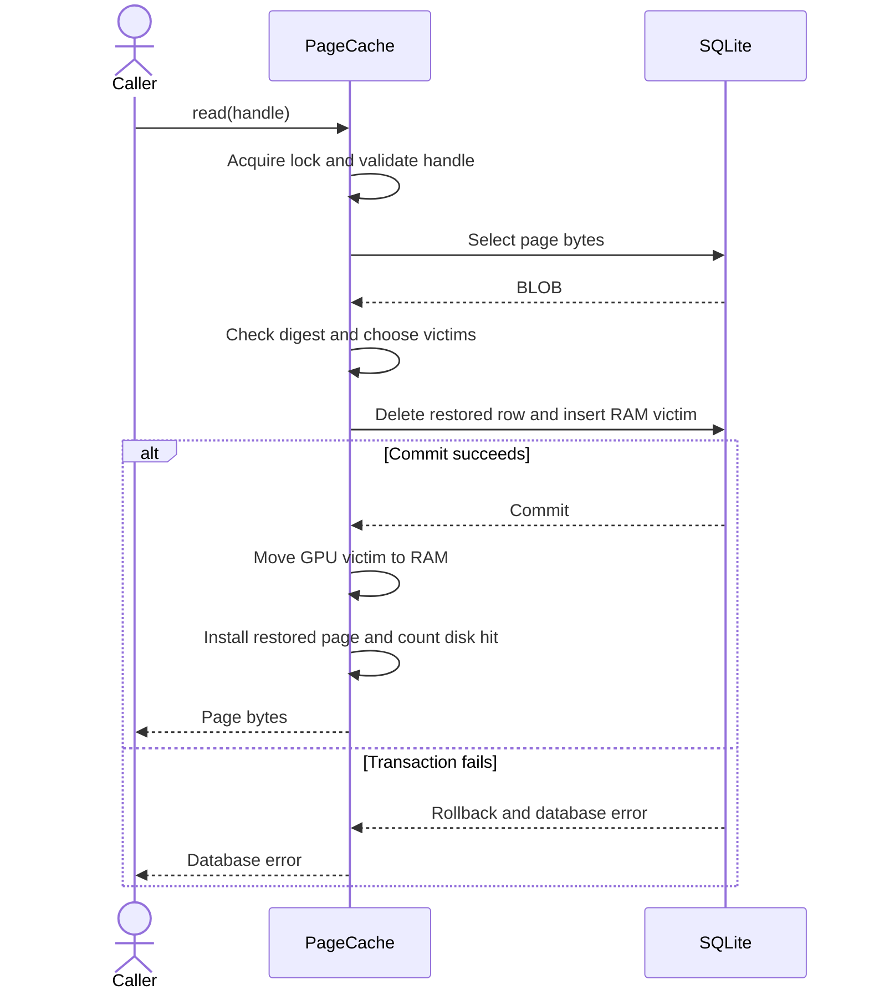

# Page cache system design

A serving process can store immutable byte pages and keep a stable handle as each page changes tier. The caller owns tensor serialization, page boundaries, and request lifetime. Each cache instance owns its lock, index, and temporary database.

## Storage model

| Component | Representation | Purpose |
| --- | --- | --- |
| Handle | Frozen cache UUID and allocation number | Reject foreign handles and released allocations. |
| Allocation index | Allocation number to SHA-256 digest | Track live pages and verify bytes on disk restore. |
| GPU and RAM tiers | Two ordered dictionaries of Python bytes | Model slot capacity and least-recently-used order. |
| Disk tier | SQLite table with an integer key and a BLOB | Store pages that leave RAM. |
| Pin counts | Counter keyed by allocation number | Keep a page in the GPU tier across a caller's critical section. |

The GPU and RAM tier names describe simulated placement. SQLite issues real filesystem operations through the operating system. Each cache creates its database in a private temporary directory.

## Admission and promotion

A new page enters the GPU tier. A GPU hit moves the page to the newest position. A RAM or disk hit promotes the requested page. Admission chooses the oldest unpinned GPU victim. Its demotion can send the oldest RAM page to disk. A RAM hit frees its own slot for the GPU victim.

The diagram shows a disk read with both resident tiers full and an available GPU victim.

SQLite commits before the cache changes either resident dictionary. A missing row or a checksum failure raises `CorruptPage` before admission. Failed reads leave the hit counts unchanged.

## Concurrency and lifetime

A reentrant lock serializes index updates, reads, and database writes within one process. Disk latency can delay calls on unrelated pages. A pin first reads the page and increments its count under the same lock. The caller then uses the bytes outside the lock. Exiting the pin context decrements the count, including when caller code raises an exception.

A live handle identifies one allocation even when a different page has identical bytes. Release removes the page and its digest. A fresh allocation uses a new number. Close requires all pins to end and removes the temporary database. Process restart requires a new cache and new handles.

The slot limits bound payload counts. Caller references can retain returned bytes after release. Python metadata, SQLite pages, and transaction journals add storage costs.

The [implementation](../tiered_kv_cache/cache.py) defines the API. The [cache tests](../tests/test_cache.py) exercise transaction rollback, corruption, concurrent reads, capacity, and pin lifetime.
