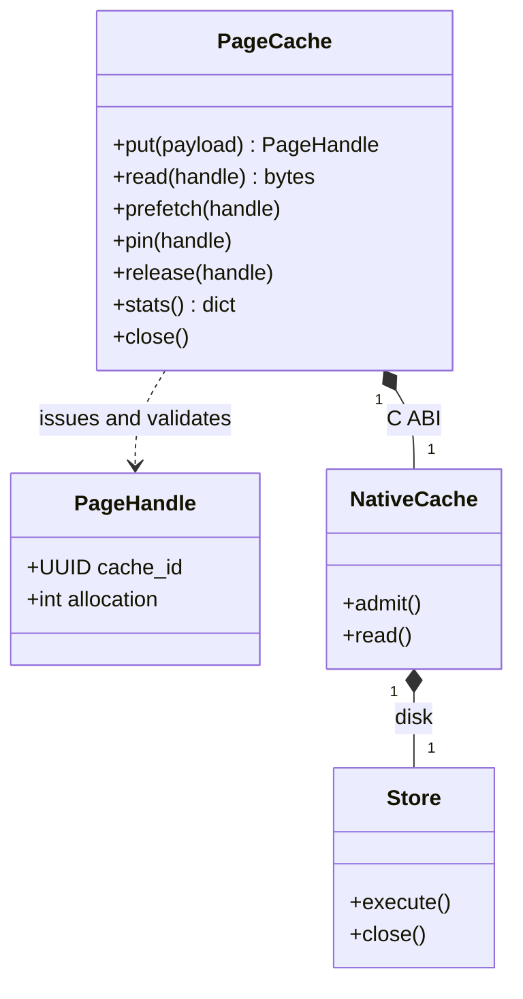

# Page cache system design

A serving process can store immutable byte pages and keep a stable handle as each page changes tier. The caller owns tensor serialization, page boundaries, and request lifetime. Each cache instance owns its lock, index, and temporary database.

## Storage model

| Component | Representation | Purpose |
| --- | --- | --- |
| Handle | Frozen cache UUID and allocation number | Reject foreign handles and released allocations. |
| Allocation index | Zig hash map from allocation number to page metadata | Track live pages and verify bytes on disk restore. |
| GPU and RAM tiers | Owned Zig buffers, tier tags, and monotonically increasing access stamps | Model slot capacity and least-recently-used order. |
| Disk tier | SQLite table with an integer key and a BLOB | Store pages that leave RAM. |
| Pin counts | Pin count in each allocation record | Keep a page in the GPU tier across a caller's critical section. |

The GPU and RAM tier names describe simulated placement. SQLite issues real filesystem operations through the operating system. Python creates a private temporary directory. The native CLI creates a temporary file on the selected volume.

## Runtime contracts

- [Page placement and the disk transaction](design/placement.md) traces a disk restore through both resident tiers.
- [Handle ownership and pin lifetime](design/handles.md) explains the native and Python ownership rules.
- [Measurement design](design/measurement.md) defines the timed operation and the paired reference.
